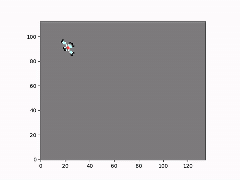
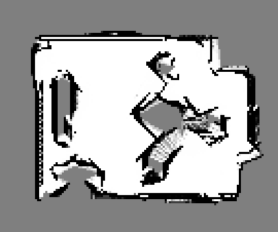

<div align="center">

# Occupancy Grid Mapping

**Probabilistic 2D mapping of an unknown environment from robot odometry and ultrasonic range sensors**




*The map builds up as the robot (red dot) drives its trajectory and sweeps the environment with its ultrasonic sensor cones (cyan).*

</div>

---

## Table of Contents
- [Overview](#overview)
- [Key Features](#key-features)
- [Results](#results)
- [Methodology](#methodology)
- [Getting Started](#getting-started)
- [Project Structure](#project-structure)
- [Future Work](#future-work)
- [Author](#author)

## Overview
Occupancy grid mapping is a core building block of autonomous navigation: before a robot can plan a path, it needs a map of what is free and what is blocked.

This project implements the full mapping pipeline in **dependency-free C++17**. It reads logged robot poses (x, y, heading) and four ultrasonic time-of-flight readings, models each sensor as a 30° cone, ray-traces the beams through a discretized grid, and fuses thousands of noisy measurements into a single probabilistic map using **Bayesian log-odds updates**.

## Key Features
- **Bayesian log-odds fusion.** Each cell's occupancy probability is refined with every measurement, and readings that conflict average out naturally.
- **Realistic ultrasonic model.** Every 30° cone is sampled with 9 rays, so obstacles off the beam axis are still detected.
- **Bresenham ray tracing.** Integer-only traversal marks the cells along each ray as free and the cell it hits as occupied.
- **Sensor-to-world transforms.** Each sensor's mounting offset and angle are rotated into the world frame using the robot's heading.
- **Auto-sized grid.** The map extent comes from the trajectory, plus 1 m of padding.
- **Two output formats:** a grayscale image (`.pgm`) and a full probability matrix (`.csv`) for further analysis.

## Results
<div align="center">


*Final map (135 × 113 cells at 5 cm resolution): black = occupied, white = free, gray = unexplored.*
</div>

The resulting map clearly recovers the outer walls and the interior obstacles of the environment from low-cost ultrasonic sensors alone.

## Methodology

**1. Time of flight to distance.** The round-trip echo time *t* is converted to distance with the speed of sound:

$$d = \frac{t \cdot 343}{2}$$

**2. Sensor pose in world coordinates.** For a sensor mounted at offset $(o_x, o_y)$ on a robot at $(x, y, \theta)$:

$$S_x = x + o_x\cos\theta - o_y\sin\theta \qquad S_y = y + o_x\sin\theta + o_y\cos\theta$$

**3. Inverse sensor model.** Cells along each ray receive a *free* update, and the end cell receives an *occupied* update, unless the reading is at maximum range (no echo):

$$l_{occ} = \ln\frac{0.85}{0.15} \qquad l_{free} = \ln\frac{0.35}{0.65}$$

**4. Back to probability** for visualization:

$$P = 1 - \frac{1}{1 + e^{L}}$$

| Parameter | Value |
|-----------|-------|
| Grid resolution | 0.05 m |
| Map padding | 1.0 m |
| Sensor cone | 30° (9 rays) |
| Max sensor range | 2.0 m |
| P(occupied) / P(free) | 0.85 / 0.35 |

## Getting Started

### Prerequisites
Any C++17 compiler (GCC, Clang or MSVC). No external libraries are needed.

### Build & run
```bash
git clone https://github.com/abdallahnafady54321-bit/occupancy-grid-mapping.git
cd occupancy-grid-mapping

g++ -std=c++17 -O2 -o occupancy_grid_map src/occupancy_grid_map.cpp
./occupancy_grid_map                       # uses data/robot.csv -> results/
./occupancy_grid_map my_log.csv my_output  # custom input / output folder
```

### Input format
`data/robot.csv` is a CSV file with a header row:
```
timestamp, pos_x, pos_y, heading, ultrasound0, ultrasound1, ultrasound2, ultrasound3
```
Positions are in metres, heading is in radians, and the ultrasound values are time of flight in seconds.

## Project Structure
```
occupancy-grid-mapping/
├── src/
│   └── occupancy_grid_map.cpp   # Mapping implementation
├── data/
│   └── robot.csv                # Recorded pose + ultrasonic log
├── results/
│   ├── occupancy_grid.pgm       # Output map (image)
│   └── occupancy_grid.csv       # Output map (probabilities)
├── images/                      # README figures and animation
└── docs/
    └── report.pdf               # Technical report
```

## Future Work
- Add a beam-based sensor model with Gaussian range noise.
- Run full SLAM by correcting odometry drift with scan matching.
- Visualize the map live in real time, for example with ROS 2 and RViz.

## Author
**Abdallah Yasser**, Mechatronics Engineering
[GitHub](https://github.com/abdallahnafady54321-bit)

## License
This project is licensed under the MIT License. See [LICENSE](LICENSE) for details.
